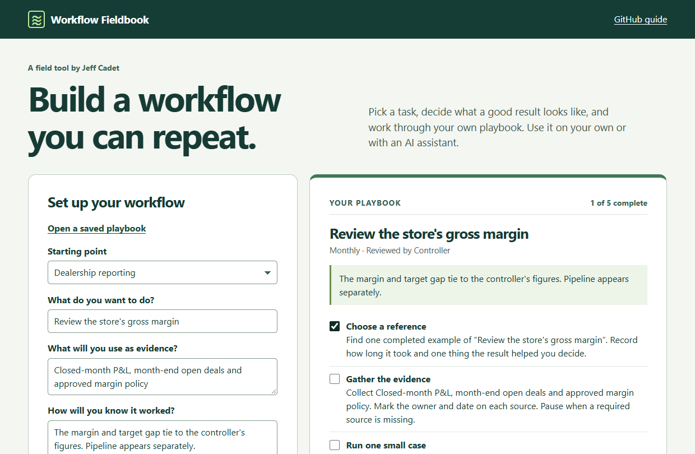

# Workflow Fieldbook

**[Open the free browser tool](https://edcadet10.github.io/claude-executive-automation-playbook/)**

Choose a weekly plan, team handoff, dealership report, housing review or a blank workflow. Set your own goal, run the checklist and record what happened. Save an editable copy to reopen later, download Markdown, or print a PDF. Anyone can use it without signing in, installing software or paying for AI. Entries stay in your tab until you save a file.

Prefer working on paper or in a text editor? [Get the plain-text worksheet](docs/worksheet.txt).

## For consultants and technical teams

**A one-on-one implementation playbook by Jeff Cadet.** Start with the last decision the executive had to make. Rebuild the evidence behind it, give Claude a narrow job, then have the executive operate the workflow without the consultant.

The worked engagement is a dealership month-end review. Sales sees an open deal pipeline. Finance sees an accrual P&L. The controller maintains a gross-margin threshold. The executive needs to know whether the store missed that threshold, by how much, and which question to take into the operating meeting.

| Start here | What you leave with |
| --- | --- |
| [Run the engagement](playbook/engagement.md) | A 30-minute fit call, discovery workpaper, 14-hour core workshop and optional seven-hour extension |
| [Meet the practitioner](playbook/jeff-cadet.md) | Public examples to demonstrate, how Jeff teaches with them and what to confirm before an engagement |
| [Run the reporting lab](playbook/reporting-lab.md) | A reproducible month-end packet, controller tie-out, failure drills and a housing-investment exercise |
| [Teach Claude Code and MCP](playbook/claude-workshop.md) | An executable read-only MCP server, a reusable skill, a review agent and fresh-session exercises |
| [Commission client integrations](playbook/integrations.md) | HubSpot, QuickBooks Online and Microsoft 365 runbooks with source mappings, authorization checks and vendor documentation |
| [Operate and hand over the workflow](playbook/operations.md) | A durable review ledger, opt-in Claude drafting, a Linux timer, recovery drills and owner acceptance criteria |

### Verify the implementation

Run `python -m lab.report` for the worked case and `python -m unittest discover -s tests -v` for its regression suite. The integration check uses a real MCP process. CI also fires the packaged timer on a disposable Linux host, then replays the job and checks for the same draft ID. Model-backed narrative generation requires a working Claude account. [CI runs](https://github.com/edcadet10/claude-executive-automation-playbook/actions/workflows/lab.yml) · [Sequential pull requests](https://github.com/edcadet10/claude-executive-automation-playbook/pulls?q=is%3Apr+is%3Amerged)

All dealership figures, identifiers and policies in this repository are fictional. Keep engagement workpapers in the client's private workspace.
